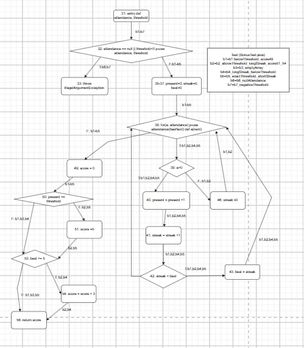

## Лаб 10: Өгөгдлийн урсгалын тест(DU хосууд)

Оюутны нэр: Ё.Болормаа
Оюутны код: B222270050

## Орчин

bolopoo@Ubuntu:~/Downloads/lab10-dataflow$ java --version
openjdk 17.0.20.1 2026-08-18
OpenJDK Runtime Environment (build 17.0.20.1+1-1-26.04-Ubuntu)
OpenJDK 64-Bit Server VM (build 17.0.20.1+1-1-26.04-Ubuntu, mixed mode, sharing)

bolopoo@Ubuntu:~/Downloads/lab10-dataflow$ mvn --version
Apache Maven 3.9.12
Maven home: /usr/share/maven
Java version: 17.0.20.1, vendor: Ubuntu, runtime: /usr/lib/jvm/java-17-openjdk-amd64
Default locale: en_US, platform encoding: UTF-8
OS name: "linux", version: "7.0.0-38-generic", arch: "amd64", family: "unix"

## Хэсэг А: gcd

### Def/use 

| Мөр | Код | Def | Use |
|---|---|---|---|
| 13 | 'gcd(int x, int y)' | x, y | | 
| 15 | 'while (y != 0)' | | y (p-use) |
| 16 | 'tmp = x % y;' | tmp | x (c), y (c) |
| 17 | 'x = y;' | x | y (c) |
| 18 | 'y = tmp;'  | y | tmp (c) |
| 20 | 'return x; ' | | x (c) |

### DU хосын хүснэгт

| Хувьсагч | Def | Use | Төрөл | Def-clear зам | Тестийн ID | Хамрагдсан |
|---|---|---|---|---|---|---|
| x | 13 | 16 | c-use | 13 -> 15(T) -> 16 | T2, T3 | тийм |
| x | 13 | 20 | c-use | 13 -> 15(F)-> 20 | T1 | тийм |
| x | 17 | 16 | c-use | 17 -> 18 -> 15(T) -> 16 | T2 | тийм |
| x | 17 | 20 | c-use | 17 -> 18 -> 15(F) -> 20 | T2, T3 | тийм |
| y | 13 | 15 | p-use | 13->15 (T ба F) | T1 (F), T2 (T) | тийм |
| y | 13 | 16 | c-use | 13->15(T)->16 | T2, T3 | тийм |
| y | 13 | 17 | c-use | 13->15(T)->16->17 | T2, T3 | тийм |
| y | 18 | 15 | p-use | 18->15 | T2, T3 | тийм |
| y | 18 | 16 | c-use | 18->15(T)->16 | T2 | тийм |
| y | 18 | 17 | c-use | 18->15(T)->16->17 | T2 | тийм |
| tmp | 16 | 18 | c-use | 16->17->18 | T2, T3 | тийм |

Нийт 11 хос. Мөр 17 (`x = y`) нь x-ийн def бөгөөд use биш, тиймээс x-ийн (13,17) гэсэн хос байхгүй. Мөр 17 нь 13-ын x-ийг ална (kill), тиймээс (13,20) зөвхөн давталтад ороогүй замаар л def-clear байна. Лекцийн хүснэгтэд дутуу байсан хосууд: x(17,16), y(13,17), y(18,16), y(18,17), tmp(16,18).

### Тестүүд (GcdTest.java)
 
| ID | Оролт | Хариу | Хамарсан хос |
|---|---|---|---|
| T1 | gcd(7,0) | 7 | x(13,20), y(13,15) F |
| T2 | gcd(12,8) | 4 | бусад бүх хос |
| T3 | gcd(0,5) | 5 | нэмэлт: 1 давталттай тохиолдол |

- 'gcd(7,0)' нь давталтад огт ордоггүй тул x(13,20) хосыг ГАНЦААРАА хамарна. Өөр ямар ч оролт үүнийг хамрахгүй, учир нь давталтад орвол мөр 17 нь x-ийг ална.
- 'gcd(12,8)' нь 12,8 -> 8,4 -> 4,0 гэж 2 давталт хийнэ. Давталт шаарддаг хосууд: x(13,16), x(17,16), x(17,20), y(13,16), y(13,17), y(18,15), y(18,16), y(18,17), tmp(16,18). Үүнээс дор хаяж 2 давталт шаарддаг нь x(17,16), y(18,16), y(18,17), учир нь def нь эхний давталтаас гарсан утгыг дараагийн давталт хэрэглэнэ.

## Хэсэг B: bonus

### B1: CFG

### B2: Def/use жагсаалт (файлын мөрийн дугаар)

| Мөр | Код | Def | Use |
|---|---|---|---|
| 31 | 'bonus(int[] attendance, int threshold)' | attendance, threshold | |
| 32 | 'if (attendance == null \|\| threshold < 0)' | | attendance (p), threshold (p) |
| 35 | 'int present = 0;' | present | |
| 36 | 'int streak = 0;' | streak | |
| 37 | 'int best = 0;' | best | |
| 38 | 'for (int a : attendance)' | a | attendance (p) |
| 39 | 'if (a > 0)' | | a (p) |
| 40 | 'present = present + 1;' | present | present (c) |
| 41 | 'streak = streak + 1;' | streak | streak (c) |
| 42 | 'if (streak > best)' | | streak (p), best (p) |
| 43 | 'best = streak;' | best | streak (c) |
| 46 | 'streak = 0;' | streak | |
| 49 | 'int score = 0;' | score | |
| 50 | 'if (present >= threshold)' | | present (p), threshold (p) |
| 51 | 'score = 5;' | score | |
| 53 | 'if (best >= 5)' | | best (p) |
| 54 | 'score = score + 3;' | score | score (c) |
| 56 | 'return score;' | | score (c) |

Мөр 32-т `||`-ийн богино залгалтаас болж threshold нь зөвхөн attendance != null үед шалгагдана.

### B4 шат 1: ALL-DEFS

All-defs-ийг хангахад **2 тест** хэрэгтэй.

- B1: 'bonus({1,0}, 2)' нь present=1 < 2 тул 50-р мөрийн нөхцөл худал, score-ийн 49-р def нь 56-р мөрөнд хүрнэ.
- B2: 'bonus({1,0,1,1,1,1,1}, 3)' нь present=6 >= 3 тул 51-р def үүсэж, best=5 >= 5 тул 54-р def үүсэж 56-д хүрнэ. Дунд нь 0 байгаа тул 46-р def нь дараагийн 41-р мөрөнд use-д хүрнэ.

Яагаад 1 тестээр болохгүй вэ: score-ийн 49 ба 51 def-ийг нэг гүйцэтгэлд use-д хүргэх боломжгүй. Мөр 51 ажиллавал 49-ийн утгыг дарж бичнэ (kill), тэгэхээр 49 нь use-д хүрэхгүй. Харин 49 нь use-д хүрэхийн тулд 51 ажиллахгүй байх ёстой, өөрөөр хэлбэл 'present < threshold'  хэрэгтэй, 51 нь `present >= threshold` хэрэгтэй. Эдгээр нөхцөл нэг гүйцэтгэлд зэрэг биелэхгүй тул хамгийн цөөндөө 2 тест.

### JaCoCo (results/jacoco-alldefs.csv)

| Үзүүлэлт | Дутуу | Хамрагдсан |
|---|---|---|
| Branch | 2 | 14 |
| Line | 2 | 22 |

All-defs хангагдсан ч branch 100% биш: line 32-ын `attendance == null`, `threshold < 0` нөхцөлүүдийн true салаа (exception шидэх) хамрагдаагүй. Эдгээрийн тест нь all-DU-pairs шатанд нэмэгдэнэ.

### B3: DU хосын хүснэгт

Тест: B1 = `{1,0}, 2` · B2 = `{1,0,1,1,1,1,1}, 3` · B3 = `{}, 1` · B4 = `{1,1,1,1,1}, 6` · B5 = `{1,1}, 2` · B6 = `null, 1` · B7 = `{1}, -1`

| Хувьсагч | Def | Use | Төрөл | Def-clear зам | Тестийн ID |
|---|---|---|---|---|---|
| present | 35 | 40 | c | 35 -> 38 -> 39(T) -> 40 | B1, B2 |
| present | 35 | 50 | p | 35 -> 38(F) -> 50 (ирсэн өдөр байхгүй) | B3 |
| present | 40 | 40 | c | 40 -> 41 -> 42 -> 38 -> 39(T) -> 40 | B2 |
| present | 40 | 50 | p | 40 -> ... -> 38(F) -> 50 | B1, B2 |
| streak | 36 | 41 | c | 36 -> 38 -> 39(T) -> 40 -> 41 | B1, B2 |
| streak | 41 | 41 | c | 41 -> 42 -> 38 -> 39(T) -> 40 -> 41 (дараалласан ирц) | B2 |
| streak | 41 | 42 | p | 41 -> 42 | B1, B2 |
| streak | 41 | 43 | c | 41 -> 42(T) -> 43 | B1, B2 |
| streak | 46 | 41 | c | 46 -> 38 -> 39(T) -> 40 -> 41 (тасалсны дараа ирсэн) | B2 |
| best | 37 | 42 | p | 37 -> 38 -> 39(T) -> 40 -> 41 -> 42 (эхний ирсэн өдөр) | B1 |
| best | 37 | 53 | p | 37 -> 38(F) -> 50 -> 53 (ирсэн өдөр байхгүй) | B3 |
| best | 43 | 42 | p | 43 -> 38->39(T)->40->41->42 | B2 |
| best | 43 | 53 | p | 43->38(F)->50->53 | B1, B2 |
| a | 38 | 39 | p | 38->39 | B1 |
| attendance | 31 | 32 | p | 31->32 | B1 (F), B6 (T) |
| attendance | 31 | 38 | p | 31->32(F)->...->38 | B1, B3 |
| threshold | 31 | 32 | p | 31->32 (`\|\|`-д attendance != null үед) | B1 (F), B7 (T) |
| threshold | 31 | 50 | p | 31->...->50 | B1, B5 |
| score | 49 | 54 | c | 49->50(F)->53(T)->54 | B4 |
| score | 49 | 56 | c | 49->50(F)->53(F)->56 | B1, B3 |
| score | 51 | 54 | c | 51->53(T)->54 | B2 |
| score | 51 | 56 | c | 51->53(F)->56 | B5 |
| score | 54 | 56 | c | 54->56 | B2, B4 |

Нийт 23 хос.

### Kill (мөр 46 болон бусад дахин тодорхойлолт)

Мөр 46 ('streak = 0') нь streak-ийн 36 ба 41 def-ийг ална. Мөн 41 нь 36 ба 46-г, 43 нь 37-г, 51 нь 49-г, 54 нь 49 ба 51-г ална. Иймээс дараах хослолууд def-clear замгүй тул DU хос гэж тоолоогүй:

- streak (36,42), (36,43): хооронд нь мөр 41 streak-ийг дахин тодорхойлно.
- streak (46,42), (46,43): 46-аас 42 хүрэхээс өмнө заавал 41 ажиллана.

### Биелэгдэшгүй зүйлс

- best (37,42)-ийн F салаа: эхний ирсэн өдөр streak=1 > best=0 тул нөхцөл үргэлж үнэн.
- best (37,53)-ийн T салаа (best >= 5): 37-оос шинэчлэгдээгүй best нь 0 тул 'best >= 5' үргэлж худал байна.
